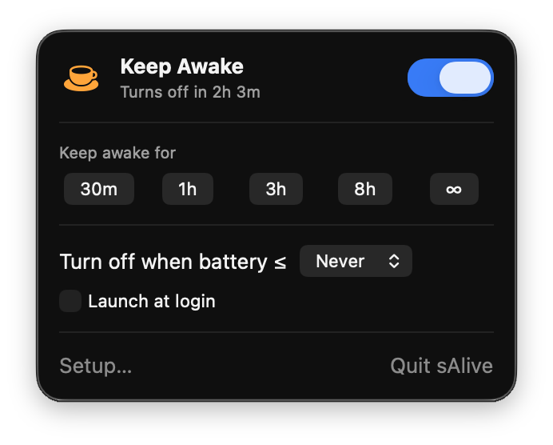
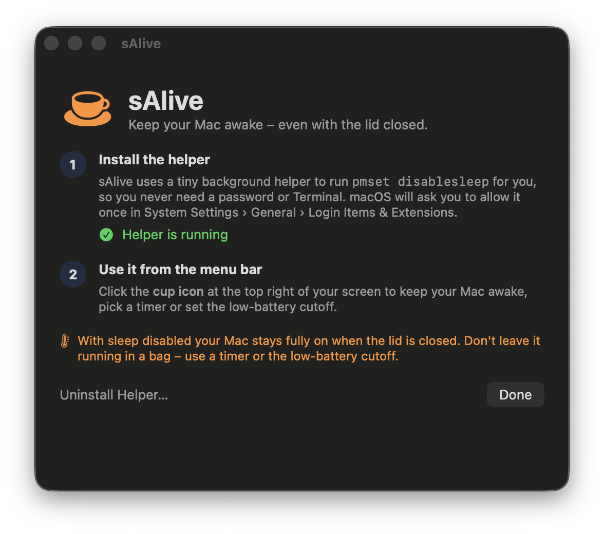
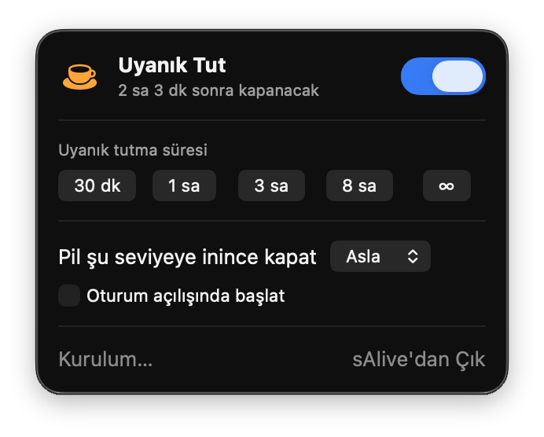
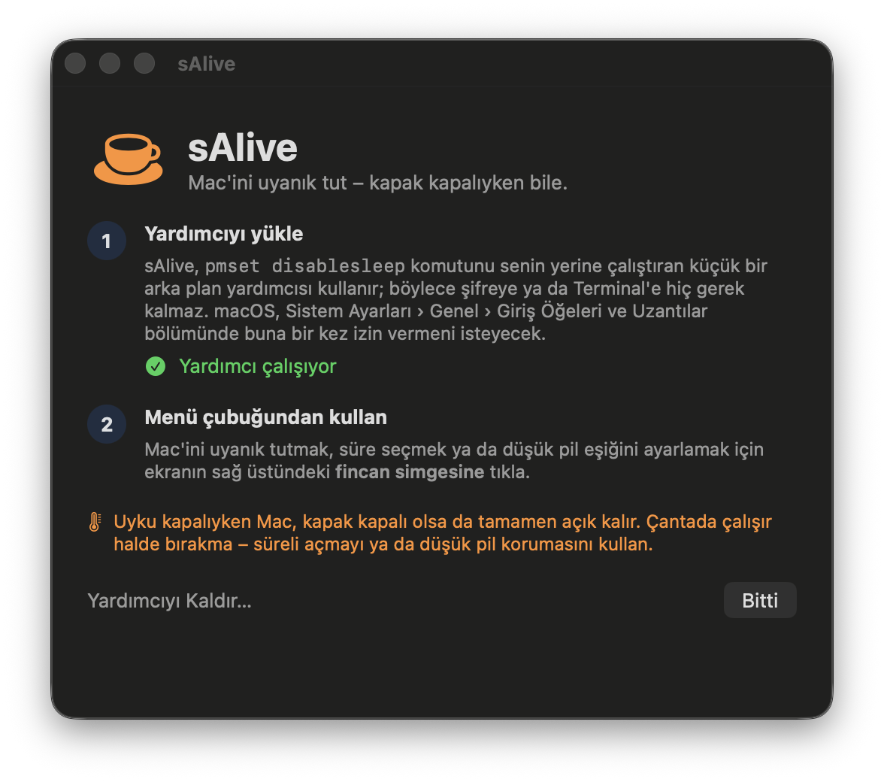

# sAlive ☕️

**Keep your Mac awake from the menu bar – even with the lid closed.**
One tap instead of `sudo pmset -a disablesleep 1`.

<p align="center">
  
</p>

[Türkçe](#türkçe) · [English](#english)

---

## English

macOS puts your Mac to sleep after a while once the display turns off or the lid closes – even with "prevent sleep" style settings. The only reliable fix is `sudo pmset -a disablesleep 1`, which means opening Terminal and typing your password every time.

sAlive turns that into a button:

- **Menu bar icon** – one click on/off, timers (30 min · 1 h · 3 h · 8 h · ∞), status
- **Auto-off timer** – survives app quit and reboot
- **Low-battery cutoff** – turns itself off at 10 / 20 / 30 / 50 % on battery
- **CLI** – `salive on 2h`, `salive off`, `salive status`
- **English & Turkish** – follows your system language (override per app in *System Settings › General › Language & Region*)
- **No password prompts, no sudoers hacks** – a small signed helper registered with Apple's `SMAppService`, which you approve once in System Settings

<p align="center">
  
</p>

### Install

```sh
brew install --cask fcemtopall/tap/salive
```

Or download the notarized `sAlive-x.y.z.zip` from [Releases](https://github.com/fcemtopall/sAlive/releases) and drag `sAlive.app` to `/Applications`.

Then:

1. Open **sAlive** (or run `salive on`). It sets up its helper and opens *System Settings › General › Login Items & Extensions*.
2. Turn on **sAlive** there – the one approval macOS requires. Done.
3. Use the ☕️ icon in the menu bar.

Requires macOS 26 (Tahoe) or later.

### CLI

```
salive on [DURATION]      # e.g. salive on, salive on 90m, salive on 1h30m
salive off
salive toggle
salive status
salive battery 20         # auto-off at 20 % battery (salive battery off to disable)
```

### ⚠️ Heads-up

With sleep disabled your Mac stays fully on with the lid closed. Don't leave it running in a bag – use a timer or the battery cutoff.

### Update

```sh
brew upgrade --cask fcemtopall/tap/salive
```

(Use the full name: Homebrew only upgrades third-party taps you've trusted, and naming it trusts it.)

### Uninstall

```sh
brew uninstall --cask salive        # add --zap to remove saved settings
```

(Uninstalling turns keep-awake off first.) Manual install: open sAlive › Setup… › Uninstall Helper, then delete the app.

### How it works

```
Menu bar app ──┬── XPC (code-signature checked) ──► sAliveHelper (root, launchd)
salive CLI ────┘                                     └─ /usr/bin/pmset -a disablesleep 0|1
```

The helper only accepts connections from binaries signed by the same Apple Developer team, runs `pmset` with fixed arguments, and stores the timer / battery cutoff in `/Library/Application Support/sAlive/state.json`. Current state is always read from `pmset -g`, so changes made in Terminal show up too.

### Building

```sh
brew install xcodegen
xcodegen generate
open sAlive.xcodeproj
# or: scripts/dev-install.sh   (build Debug + install to /Applications)
```

Forks: set your own Team ID in `project.yml` (`DEVELOPMENT_TEAM`) **and** `Shared/Constants.swift` (`SAlive.teamID`), and change the `io.github.fcemtopall` bundle IDs.

> If your checkout lives in an iCloud-synced folder (Desktop/Documents), keep DerivedData outside it – iCloud's extended attributes break code signing.

Translations live in `App/Localizable.xcstrings` (edit in Xcode; new languages welcome).

Releasing (runs locally – no secrets are stored on GitHub): bump `MARKETING_VERSION` in `project.yml`, commit, then run `scripts/release.sh --publish`. It signs with your Developer ID certificate, notarizes with the `salive-notary` notarytool keychain profile, tags the version, publishes the GitHub release and updates the Homebrew tap using your `gh` login. Without `--publish` it only builds the notarized zip into `dist/`.

---

## Türkçe

Mac'inizde ekran kapandığında ya da kapağı kapattığınızda, uyanık tutma ayarları açık olsa bile bir süre sonra bilgisayar uykuya geçer. Güvenilir tek çözüm `sudo pmset -a disablesleep 1` – yani her seferinde Terminal ve şifre.

sAlive bunu tek bir düğmeye çevirir:

- **Menü çubuğu ikonu** – tek tıkla aç/kapat, süreli açma (30 dk · 1 sa · 3 sa · 8 sa · ∞)
- **Otomatik kapanma** – uygulama kapansa da, bilgisayar yeniden başlasa da çalışır
- **Düşük pil koruması** – pilde %10 / 20 / 30 / 50'ye inince kendini kapatır
- **Terminal komutu** – `salive on 2h`, `salive off`, `salive status`
- **Türkçe ve İngilizce** – sistem dilini izler (uygulama bazında *Sistem Ayarları › Genel › Dil ve Bölge*'den değiştirilebilir)
- **Şifre yok, sudoers ayarı yok** – Apple'ın `SMAppService` altyapısıyla kayıtlı, imzalı küçük bir yardımcı servis; Ayarlar'dan bir kez onaylarsınız

<p align="center">
  
  
</p>

### Kurulum

```sh
brew install --cask fcemtopall/tap/salive
```

Ya da [Releases](https://github.com/fcemtopall/sAlive/releases) sayfasından notarize edilmiş zip'i indirip `sAlive.app`'i `/Applications`'a sürükleyin.

1. **sAlive**'ı açın (ya da `salive on` yazın). Yardımcıyı kendisi kurar ve *Sistem Ayarları › Genel › Giriş Öğeleri ve Uzantılar*'ı açar.
2. Orada **sAlive**'ı açın – macOS'un istediği tek onay bu. Bitti.
3. Menü çubuğundaki ☕️ simgesini kullanın.

macOS 26 (Tahoe) veya üstü gerekir.

### ⚠️ Uyarı

Uyku kapalıyken kapak kapalı olsa da Mac tamamen açık kalır. Çantada çalışır halde bırakmayın – süreli açmayı veya pil korumasını kullanın.

### Güncelleme

```sh
brew upgrade --cask fcemtopall/tap/salive
```

(Tam adı kullanın: Homebrew, güvenilir olarak işaretlenmemiş üçüncü parti tap'leri güncellemez; tam adı yazmak onu güvenilir yapar.)

### Kaldırma

```sh
brew uninstall --cask salive        # ayarları da silmek için --zap
```

## License

MIT – see [LICENSE](LICENSE).
